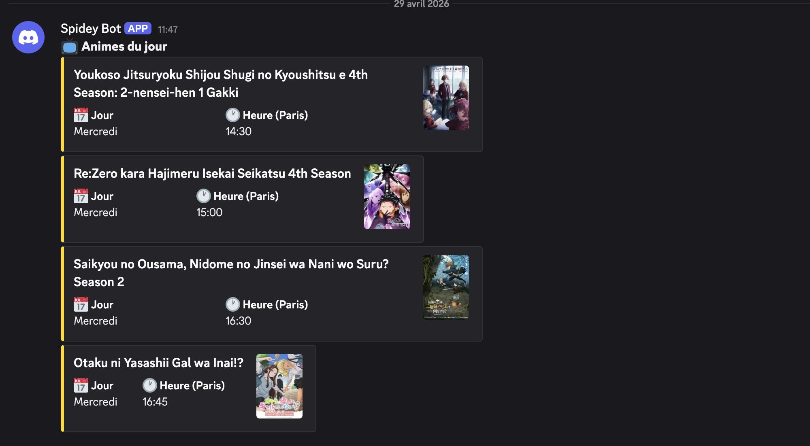

# Anime Daily Drop

Programme en Go pour récupérer le planning des animes de la saison en cours, avec envoie du planning sur Discord (Webhook) ou accessible dans le terminal.

## Fonctionnement

Le programme utilise l'API **[Jikan v4](https://jikan.moe/)** — un wrapper non-officiel de [MyAnimeList](https://myanimelist.net/), pour récupérer les animes diffusés cette saison. Les horaires de diffusion sont en JST (heure japonaise) et sont automatiquement convertis en heure de Paris (CET/CEST).

Endpoint utilisé : `GET https://api.jikan.moe/v4/seasons/now`

## Utilisation

```bash
go run main.go               # planning de toute la semaine
go run main.go today         # animes diffusés aujourd'hui
go run main.go discord       # envoyer la semaine sur Discord
go run main.go discord today # envoyer aujourd'hui sur Discord
```

## Notifications Discord

Crée le fichier `.env` à la racine du projet :

```sh
cp .env.example .env
```

Et compléter le avec le webhook du salon de votre serveur discord :

```
DISCORD_WEBHOOK="https://discord.com/api/webhooks/..."
```

Le webhook envoie un embed par anime avec l'image en haute résolution, le jour et l'heure de diffusion (Paris).

Les animes du jour sont mis en couleur or, les autres en bleu.

## Exemple de notification discord


